# Deployment Guides

Full-suite deployment is a linear chain — do not skip or reorder phases.
Click a node to open its guide:

> **Mode support boundary (suite-wide rule).** Dev mode is for development
> only and is never supported in production. Docker/Compose mode is partially
> production-supported: single-host, edge and air-gapped appliance deployments
> that follow a product's explicitly documented production Compose path are
> supported within their stated limits, but Compose cannot provide clustering,
> high availability or horizontal scaling. Kubernetes (k3s + Helm, the chain
> below) is the strongly recommended, full-featured production form. Edge
> products (NereidEdge, NereidInference) have no Kubernetes mode — their
> production form is the Open Horizon service definition delivered by
> NereidHorizon. See the root README "Deployment modes and support boundaries"
> and [deploy-standards §15.14](../deploy-standards.md).

```mermaid
flowchart LR
    classDef host fill:#eef2f7,stroke:#8a97a8,color:#1f2933
    classDef phase fill:#e3f2fd,stroke:#1976d2,color:#0d2b45
    classDef verify fill:#e8f5e9,stroke:#388e3c,color:#14391a

    A["<b>Host preparation</b><br/>OS · network · NFS · Docker"]:::host --> B
    B["<b>Phase -1</b><br/>Cluster bootstrap<br/>bare metal → k3s → Rancher"]:::phase --> C
    C["<b>Phase 0</b><br/>Shared prerequisites<br/>cert-manager · nfs-csi · GPU plugins"]:::phase --> D
    D["<b>Phase 1</b><br/>Products<br/>Identity → Sphere → Link → Horizon → Forge"]:::phase --> E
    E["<b>Phase 2</b><br/>Verification<br/>end-to-end · delivery sign-off"]:::verify

    click B "cluster-bootstrap.md" "Cluster bootstrap guide"
    click C "../../deploy/prereqs/README.md" "Cluster-shared prerequisites"
    click D "install-suite.md" "Product installation guide"
    click E "reference/fresh-cluster-checklist.md" "Fresh-cluster checklist"
```

| Phase | Guide | Output |
|---|---|---|
| -1. Cluster bootstrap | [Bootstrap k3s with Rancher](cluster-bootstrap.md) | Rancher management server + an empty managed k3s cluster |
| 0. Shared prerequisites | [`deploy/prereqs/`](../../deploy/prereqs/README.md), walkthrough in [install-suite](install-suite.md) §4 | cert-manager / internal-ca, `nfs-csi` StorageClass, GPU/NPU device plugins |
| 1. Products | [Install the NereidAI suite](install-suite.md) §6 | NereidIdentity → NereidSphere → NereidLink → NereidHorizon (Forge/edge: §7) |
| 2. Verification | [Fresh-cluster checklist](reference/fresh-cluster-checklist.md) | End-to-end checks and delivery sign-off |

The product install order inside Phase 1 is strict:
**Identity → Sphere → Link/Horizon → Forge** (Forge may run in parallel but is
verified separately; the edge stack goes last).

Reference material:

- [Accounts, DNS, and inter-product connections](reference/accounts-dns-connections.md) — credential
  baseline, DNS/Ingress naming, and the cross-product connection matrix
- [Deployment & delivery standards](../deploy-standards.md) — normative rules
  for image coordinates, Helm, Makefile, CI, and air-gapped delivery

## Single product

You do not need this chain to run one product. Every product is independently
deployable — clone only that repository and follow its own README and `docs/`.

## Air-gapped sites

Online deployment is the default path. For an offline customer site the install
steps themselves do not change — only image delivery does, entirely at the
registry/node layer. The complete operator procedure (two image classes,
`harbor-sync.sh` mirror/push/node-mirror, online/jump-host/fully-offline
scenarios) is [install-suite §2](install-suite.md#2-image-delivery-and-registries),
with the normative rules in [deploy-standards §15.2/§15.3/§15.10](../deploy-standards.md)
and deploy-standards §15.2–§15.10.
