# Public Deployment Guides

Install the suite manually on an internet-connected Kubernetes/k3s cluster.
Do not skip or reorder phases. Each product uses a versioned public GHCR OCI
chart and public images; NereidOverview supplies only shared prerequisites and
suite documentation.

> **Availability gate:** Identity, Sphere, Horizon, and Link have verified
> floating `0.0.0-dev` development artifacts; see the
> [dated evidence snapshot](reference/development-artifacts-2026-11-22.md) for
> their resolved versions and digests. Forge does not yet have a complete
> public installation channel. On an empty cluster, stop after Horizon and wait
> for a verified complete Forge release. Never install Link without healthy
> Forge SeaweedFS.

```mermaid
flowchart LR
    classDef host fill:#eef2f7,stroke:#8a97a8,color:#1f2933
    classDef phase fill:#e3f2fd,stroke:#1976d2,color:#0d2b45
    classDef blocked fill:#fff4e5,stroke:#b26a00,color:#5c3600

    C["Rancher-managed empty k3s cluster"]:::host
    P["Phase 0<br/>Shared prerequisites"]:::phase
    I["NereidIdentity"]:::phase
    S["NereidSphere"]:::phase
    H["NereidHorizon"]:::phase
    F["NereidForge<br/>complete public release required"]:::blocked
    L["NereidLink"]:::phase
    E["Open Horizon edge delivery"]:::host
    M["Separate ESS model delivery"]:::host

    C --> P --> I --> S --> H --> F --> L --> E --> M

    click C "cluster-bootstrap.md"
    click P "../../deploy/prereqs/README.md"
    click I "install-suite.md#5-phase-1--nereididentity"
    click S "install-suite.md#61-nereidsphere"
    click H "install-suite.md#62-nereidhorizon"
    click F "install-suite.md#7-forge-availability-gate"
    click L "install-suite.md#8-nereidlink-after-forge"
    click E "install-suite.md#9-open-horizon-edge-delivery"
    click M "install-suite.md#9-open-horizon-edge-delivery"
```

## Guides

| Stage | Guide | Required result |
|---|---|---|
| Cluster | [Cluster bootstrap](cluster-bootstrap.md) | Reachable, Rancher-managed empty k3s cluster with public registry access |
| Phase 0 | [Shared prerequisites](../../deploy/prereqs/README.md) and [suite guide §4](install-suite.md#4-phase-0--shared-prerequisites) | Ready cert-manager/internal-ca, working storage, and required hardware plugins |
| Products | [Suite installation](install-suite.md) | Ordered product installation with explicit values, health checks, and stop conditions |
| Acceptance | [Fresh-cluster checklist](reference/fresh-cluster-checklist.md) | Recorded health, SSO, storage, MQTT, edge, and separate ESS evidence |
| Reference | [Accounts, DNS, and connections](reference/accounts-dns-connections.md) | Matching public endpoints, secrets, and inter-product settings |
| Evidence | [2026-11-22 development artifacts](reference/development-artifacts-2026-11-22.md) | Historical resolved chart/image digests and anonymous verification scope |
| Engineering | [Public deployment standards](../deploy-standards.md) | Floating development selection, snapshot pinning, artifact verification, source ownership, and release boundaries |

## Non-negotiable ordering rules

- Identity establishes the realm and product clients before any consumer.
- Sphere is healthy before products use its ticket/session layer.
- Horizon is initialized before edge or model delivery.
- Forge completes infrastructure, Kubeflow integration, applications, and
  verification before Link starts.
- Link uses Forge SeaweedFS from its first installation; there is no temporary
  object-store stage.
- Open Horizon registration and Pattern/agreement delivery precede
  NereidEdge-to-Link acceptance.
- ESS model delivery is a separate operation after edge service delivery.
